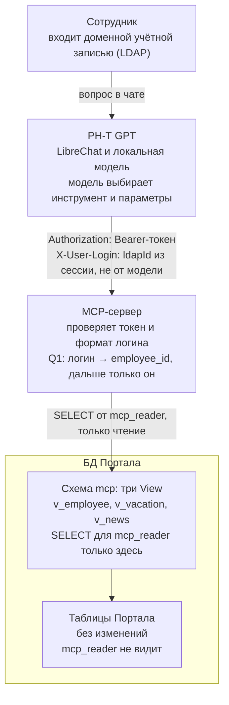

# MCP-сервер доступа к данным Портала

Записка для согласования, 26.10.2026.

Предлагается дать ассистенту РН-Т GPT доступ к справочнику сотрудников, отпускам и новостям Портала только на чтение. Код Портала при этом не меняется. Доступ идёт через отдельный MCP-сервер и набор представлений (View) в БД Портала.

## Цель и сценарии

Сотрудник задаёт вопрос в чате РН-Т GPT на естественном языке. Ассистент сам выбирает нужный инструмент MCP-сервера и отвечает по актуальным данным Портала.

| Вопрос пользователя | Инструмент MCP | Чьи данные |
| --- | --- | --- |
| «Какой телефон у Костригина?» | `search_employees` | любого сотрудника, только рабочие контакты |
| «Когда у меня отпуск?» | `get_my_vacations` | только свои |
| «Какие новости в Обществе?» | `list_news` → `get_news` | опубликованные новости |

Если запрос неоднозначен (например, на Портале два Костригина), ассистент показывает варианты с должностью и подразделением и просит уточнить. Наугад он не выбирает.

## Архитектура и принципы

Между чатом и данными Портала стоят два барьера: MCP-сервер с фиксированным набором запросов и слой View в БД. Учётная запись MCP видит только View.



Заголовки запроса ставит сервер РН-Т GPT, а не модель. Учётная запись MCP доходит только до схемы `mcp`.

1. **Код Портала не меняется.** В БД Портала добавляются только новые объекты: схема `mcp`, представления и роль. Существующие таблицы не трогаются.
2. **Отдельный MCP-сервер.** Сервис в контуре РН-Т GPT, транспорт Streamable HTTP. Доступен по сети только серверу РН-Т GPT.
3. **Только чтение, только View.** У пользователя БД `mcp_reader` есть право `SELECT` на представления схемы `mcp` и ни на что больше.
4. **Фиксированные запросы.** Модель не пишет SQL. Каждый инструмент выполняет заранее написанный параметризованный запрос.
5. **Личность пользователя не задаётся моделью.** Логин приходит из сессии РН-Т GPT в заголовке запроса, а не в параметрах инструмента (см. раздел «Передача личности пользователя»).

## Слой View в БД Портала

Контрактом между MCP-сервером и Порталом служат три представления в схеме `mcp`. Мы фиксируем их колонки и правила отбора, а тело View (из каких таблиц и как собираются данные) пишет владелец БД Портала. Поэтому структура внутренних таблиц для разработки MCP не нужна.

Зачем View, а не прямой доступ к таблицам:

- **Минимизация данных.** В View попадают только нужные колонки. Хэши паролей, личные телефоны, даты рождения и служебные таблицы MCP-серверу недоступны физически.
- **Бизнес-правила в одном месте.** Отбор «только работающие», «только опубликованные», «без удалённых» делает тот, кто знает схему Портала.
- **Устойчивость.** Если внутренние таблицы поменяются, правится тело View, а MCP-сервер остаётся как есть.

### mcp.v_employee — справочник сотрудников

| Колонка | Тип | Смысл |
| --- | --- | --- |
| `employee_id` | целое / строка | идентификатор сотрудника в БД Портала |
| `login` | строка | доменный логин (sAMAccountName) в нижнем регистре; нужен только для whoami |
| `last_name`, `first_name`, `middle_name` | строка | ФИО по отдельности, для поиска по фамилии |
| `full_name` | строка | ФИО целиком, для ответа |
| `position` | строка | должность |
| `department` | строка | подразделение |
| `work_phone` | строка | рабочий городской телефон |
| `internal_phone` | строка | внутренний номер |
| `mobile_phone` | строка | рабочий мобильный, только если он уже открыт всем на Портале |
| `email` | строка | рабочая почта |
| `office` | строка | адрес или кабинет, если есть на Портале |
| `manager_id` | как `employee_id` | непосредственный руководитель, если есть |

Отбор: только работающие сотрудники. Скрытые на Портале профили и поля не показываются. Видно ровно то, что любой сотрудник видит в карточке на Портале.

### mcp.v_vacation — отпуска

| Колонка | Тип | Смысл |
| --- | --- | --- |
| `vacation_id` | целое / строка | идентификатор записи |
| `employee_id` | как в `v_employee` | чей отпуск |
| `date_from`, `date_to` | дата | первый и последний день отпуска включительно |
| `days` | целое | количество календарных дней |
| `vacation_type` | строка | ежегодный, дополнительный, без сохранения з/п и т. п. |
| `status` | строка | по графику, согласован, перенесён — в терминах Портала |

Отбор: без удалённых и отменённых записей. Перенесённый отпуск показывается новыми датами.

### mcp.v_news — новости

| Колонка | Тип | Смысл |
| --- | --- | --- |
| `news_id` | целое / строка | идентификатор новости |
| `published_at` | дата-время | дата публикации |
| `title` | строка | заголовок |
| `summary` | строка | анонс или лид, если есть |
| `body_text` | текст | текст новости без HTML-разметки (если убрать разметку в View нельзя, это сделает MCP) |
| `category` | строка | рубрика |
| `url` | строка | ссылка на новость на Портале (или данные, из которых её можно собрать) |

Отбор: только опубликованные новости, видимые всем сотрудникам, с датой публикации не позже текущей. Черновики, архив с ограниченным доступом и новости для отдельных групп исключаются.

### Права и ограничения

Синтаксис дан для PostgreSQL; для другой СУБД всё то же делается её средствами.

```sql
CREATE SCHEMA mcp;
-- CREATE VIEW mcp.v_employee / v_vacation / v_news AS ... (тело пишет владелец БД)

CREATE ROLE mcp_reader LOGIN PASSWORD '***' CONNECTION LIMIT 5;
REVOKE ALL ON ALL TABLES IN SCHEMA public FROM mcp_reader;
GRANT USAGE ON SCHEMA mcp TO mcp_reader;
GRANT SELECT ON mcp.v_employee, mcp.v_vacation, mcp.v_news TO mcp_reader;
ALTER ROLE mcp_reader SET default_transaction_read_only = on;
ALTER ROLE mcp_reader SET statement_timeout = '5s';
```

- У `mcp_reader` нет прав ни на одну таблицу Портала, только на три View.
- Если есть реплика БД, MCP-сервер читает из неё.
- Новое поле в ответе означает новую колонку в View. Это отдельное согласование, без изменений кода Портала.

## Контракты SQL-запросов

MCP-сервер выполняет пять запросов, все к View из предыдущего раздела. Запросы приведены на общем SQL. Параметры `:name` передаются драйверу только как связанные переменные и никогда не подставляются в текст запроса.

Общие правила для всех запросов:

- У каждого запроса есть `LIMIT`. Максимум задаёт MCP-сервер, а не модель.
- Символы `%` и `_` в поисковой строке экранируются. Буквы ё и е считаются одинаковыми.
- `:me` — `employee_id` текущего пользователя. Его устанавливает запрос Q1 по логину из заголовка. Модель его не видит и передать не может.
- Рекомендуемые индексы на базовых таблицах: логин, фамилия, сотрудник + дата отпуска, дата публикации новости. Скорее всего, они уже есть; владелец БД это подтверждает.

### Q1. Кто спрашивает (whoami, внутренний)

```sql
SELECT employee_id, full_name, position, department
FROM mcp.v_employee
WHERE login = :login;  -- :login из заголовка X-User-Login, в нижнем регистре
```

Контракт: ровно одна строка. Если строк ноль или больше одной, любой инструмент с личными данными возвращает ошибку «Ваша учётная запись не найдена на Портале». Подстановки по умолчанию нет. Требование к View: `login` уникален среди работающих.

### Q2. Мои отпуска

```sql
SELECT date_from, date_to, days, vacation_type, status
FROM mcp.v_vacation
WHERE employee_id = :me
  AND date_to   >= :period_from
  AND date_from <= :period_to
ORDER BY date_from
LIMIT 50;
```

Контракт: период по умолчанию — с 1 января текущего года по 31 декабря следующего. Если передан `year`, берётся этот год. Пустой результат — нормальный ответ «отпусков за период нет», а не ошибка.

### Q3. Поиск сотрудника с контактами

```sql
SELECT e.employee_id, e.full_name, e.position, e.department,
       e.work_phone, e.internal_phone, e.mobile_phone, e.email, e.office,
       m.full_name AS manager_name
FROM mcp.v_employee e
LEFT JOIN mcp.v_employee m ON m.employee_id = e.manager_id
WHERE lower(e.last_name) LIKE lower(:q) || '%'
   OR lower(e.full_name) LIKE '%' || lower(:q) || '%'
ORDER BY e.last_name, e.first_name
LIMIT 6;
```

Контракт: `:q` — фамилия или часть ФИО, не короче 3 символов. При более чем 5 совпадениях сервер отдаёт первые 5 и признак «есть ещё, уточните». Именно для этого стоит `LIMIT 6`. Контакты идут сразу в результате поиска: на вопрос «какой телефон у Костригина» хватает одного вызова.

### Q4. Лента новостей

```sql
SELECT news_id, published_at, title, summary, category
FROM mcp.v_news
WHERE published_at >= :since
  AND (:q IS NULL
       OR lower(title)     LIKE '%' || lower(:q) || '%'
       OR lower(body_text) LIKE '%' || lower(:q) || '%')
ORDER BY published_at DESC
LIMIT :limit;
```

Контракт: `:since` по умолчанию — 30 дней назад. `:limit` — по умолчанию 5, не больше 10. Текст новости здесь не возвращается, только анонс. Если поиск по `body_text` окажется медленным, владелец БД добавит полнотекстовый индекс; контракт от этого не меняется.

### Q5. Новость целиком

```sql
SELECT news_id, published_at, title, category, body_text, url
FROM mcp.v_news
WHERE news_id = :news_id;
```

Контракт: ноль или одна строка. MCP-сервер обрезает `body_text` до 8 000 символов, чтобы не переполнять контекст модели, и добавляет ссылку на Портал.

## Инструменты MCP-сервера

Сервер публикует пять инструментов, все с пометкой `readOnlyHint: true`. Ни в одном нет параметра «логин» или «UserID текущего пользователя»: сервер сам знает, кто спрашивает.

| Инструмент | Параметры | Запрос | Возвращает |
| --- | --- | --- | --- |
| `get_my_profile` | — | Q1 | ФИО, должность, подразделение текущего пользователя |
| `get_my_vacations` | `year?` (число) | Q1 + Q2 | список отпусков текущего пользователя |
| `search_employees` | `query` (строка, ≥ 3 символов) | Q3 | до 5 карточек с рабочими контактами + признак `more` |
| `list_news` | `query?`, `days?` (по умолчанию 30), `limit?` (≤ 10) | Q4 | заголовки, даты и анонсы, свежие сверху |
| `get_news` | `news_id` | Q5 | текст новости (до 8 000 символов) и ссылка на Портал |

Требования к формату:

- Описания инструментов на русском, с примером вопроса, на который он отвечает. Например: «Отпуска текущего пользователя. Вызывай, когда спрашивают про мой отпуск».
- Ответ — компактный JSON без служебных полей, даты в ISO 8601. Пустые поля не передаются.
- Ошибки — понятный текст для пересказа пользователю (`isError: true`), без текста SQL и стека.

Пример ответа `get_my_vacations`:

```json
{
  "employee": "Иванов Иван Иванович",
  "period": { "from": "2026-01-01", "to": "2027-12-31" },
  "vacations": [
    { "from": "2026-07-13", "to": "2026-07-26", "days": 14, "type": "ежегодный", "status": "согласован" },
    { "from": "2026-12-21", "to": "2026-12-31", "days": 11, "type": "ежегодный", "status": "по графику" }
  ]
}
```

## Передача личности пользователя (whoami)

Логин спрашивающего берётся из сессии РН-Т GPT на стороне сервера и передаётся в HTTP-заголовке. Модель и пользователь на него повлиять не могут. Bearer-токен доказывает MCP-серверу, что заголовок поставил именно РН-Т GPT.

### Почему нельзя передавать логин параметром инструмента

В первоначальном варианте были `WhoAmI(login)` и `VacationInfo(Portal_DB_UserID)`. Значения параметров инструмента заполняет языковая модель, причём по тексту диалога. Отсюда два пути к чужим данным:

- Пользователь пишет «мой логин ivanov, когда у меня отпуск?», и модель передаёт `ivanov`.
- Инструкция, спрятанная в тексте новости или документа (prompt injection), заставляет модель запросить чужой ID.

Общий Bearer-токен от этого не защищает: он подтверждает, что запрос пришёл из РН-Т GPT, но не говорит, кто сидит в чате.

### Цепочка доверия

1. Сотрудник входит в РН-Т GPT доменной учётной записью через LDAP. LibreChat сохраняет в профиле `ldapId` — атрибут из каталога, который пользователь сам поменять не может.
2. При каждом вызове инструмента сервер LibreChat подставляет `ldapId` текущего авторизованного пользователя в заголовок `X-User-Login`. Это штатный механизм LibreChat (плейсхолдер `{{LIBRECHAT_USER_LDAPID}}`). Заголовок формируется из сессии, а не из текста диалога.
3. Вместе с ним идёт `Authorization: Bearer <токен>`. Токен знают только сервер РН-Т GPT и MCP-сервер.
4. MCP-сервер проверяет токен, проверяет формат логина и находит `employee_id` запросом Q1. Дальше он работает только с этим `employee_id`.

### Настройка на стороне РН-Т GPT

`.env` (секреты в репозиторий не попадают):

```
LDAP_ID=sAMAccountName
PORTAL_MCP_TOKEN=<случайная строка не короче 32 байт>
```

Внимание: LibreChat находит LDAP-пользователя по `ldapId`. Если сейчас `LDAP_ID` не задан, `ldapId` уже равен `uid` или `sAMAccountName`. Перед тем как задавать `LDAP_ID`, проверьте, какое значение хранится у существующих пользователей. Иначе при следующем входе LibreChat заведёт им новые учётные записи без истории чатов.

`librechat.yaml`:

```yaml
mcpServers:
  portal:
    type: streamable-http
    url: http://portal-mcp:8080/mcp
    headers:
      Authorization: "Bearer ${PORTAL_MCP_TOKEN}"
      X-User-Login: "{{LIBRECHAT_USER_LDAPID}}"
```

Именно `LDAPID`, а не `USERNAME`. В LDAP-интеграции LibreChat поле `username` по умолчанию заполняется именем (`givenName`), а не логином. `ldapId` при `LDAP_ID=sAMAccountName` — это именно доменный логин вида `vesharonov`. У локальных учётных записей без LDAP `ldapId` нет, и доступа к личным данным у них не будет.

### Проверки на стороне MCP-сервера

1. Нет заголовка `Authorization` или токен не совпал → HTTP 401. Сравнение в постоянном времени.
2. `X-User-Login` пуст или не соответствует формату `^[a-z0-9._-]{2,64}$` (после приведения к нижнему регистру) → ошибка. Сюда же попадает неподставленный плейсхолдер `{{...}}`.
3. Q1 вернул не ровно одну строку → ошибка «учётная запись не найдена на Портале».
4. Инструменты с личными данными берут `employee_id` только из Q1 и не принимают его от модели.

### Обязательные условия

- **Сетевая изоляция.** Порт MCP-сервера доступен только с сервера РН-Т GPT: общая docker-сеть без публикации порта наружу или правило межсетевого экрана. Тогда даже с токеном запрос с чужим логином с рабочего места не отправить.
- **Токен только в переменных окружения сервера.** Он не вводится пользователем и не виден в интерфейсе. MCP-серверы, которые пользователи создают через интерфейс, не получают подстановку `${...}` из окружения, поэтому вытащить токен через свой сервер не выйдет.
- **Ротация токена** по регламенту ИБ и при подозрении на компрометацию. MCP-сервер на время смены принимает два токена.
- **Сверка логинов до запуска.** Логин в БД Портала должен совпадать с `sAMAccountName`. Расхождения находим заранее одним запросом к View.

Если в будущем требования ИБ ужесточатся, заголовок можно заменить подписанным токеном пользователя (OAuth/OIDC через корпоративный IdP). Инструменты и View при этом не меняются.

## Персональные данные, аудит и эксплуатация

Круг доступа к данным не расширяется. Рабочие контакты и новости через MCP видит тот же круг людей, что и на Портале. Свои отпуска сотрудник видит только сам.

**Персональные данные**

- Обрабатываются только поля из View: ФИО, должность, подразделение, рабочие контакты, свои отпуска.
- Модель работает в закрытом контуре РН-Т GPT. Данные за периметр не уходят.
- Ответы ассистента сохраняются в истории чатов РН-Т GPT, как любые другие сообщения. Срок хранения определяется настройками РН-Т GPT.
- Чужие отпуска в текущий объём не входят. Если понадобятся (например, руководителю по подчинённым), это отдельное согласование и отдельный инструмент.

**Аудит**

MCP-сервер пишет журнал в формате JSON по каждому вызову: время, логин, инструмент, параметры (например, строка поиска), число строк в ответе, длительность, результат (успех или код ошибки). Содержимое ответа в журнал не пишется. Срок хранения журнала определяет ИБ.

**Ограничения нагрузки**

| Параметр | Значение |
| --- | --- |
| Соединений с БД из пула MCP | не больше 5 |
| Таймаут SQL-запроса | 5 с |
| Вызовов на одного пользователя | не больше 30 в минуту |
| Строк в одном ответе | не больше 10 |

**Развёртывание**

- MCP-сервер — отдельный контейнер в docker-compose рядом с РН-Т GPT. Порт наружу не публикуется.
- В `librechat.yaml` адрес сервера добавляется в `mcpSettings.allowedDomains`. Без этого защита от SSRF заблокирует обращения к внутреннему хосту.
- Строка подключения к БД и Bearer-токен хранятся в переменных окружения контейнера.
- Проверка работоспособности: эндпоинт `/health` выполняет `SELECT 1` из каждой View.

## Согласования и план работ

Для старта нужны три согласования: от владельца БД Портала, от ИБ и от сетевых администраторов.

| Что согласуем | С кем |
| --- | --- |
| Схема `mcp`, три View с указанными колонками и отбором, роль `mcp_reader` | владелец БД Портала |
| Перечень полей с персональными данными, передача логина в заголовке, хранение и ротация токена, состав и срок хранения журнала аудита | ИБ |
| Доступ с сервера РН-Т GPT к БД Портала (или к её реплике) по порту СУБД | сетевые администраторы |
| Объём первой версии: три сценария из раздела «Цель», чужие отпуска не входят | руководитель |

### Открытые вопросы

- [ ] Какая СУБД у Портала и есть ли реплика для чтения?
- [ ] Совпадает ли логин в БД Портала с `sAMAccountName` и уникален ли он?
- [ ] Какое значение `ldapId` сейчас хранится у пользователей РН-Т GPT?
- [ ] Есть ли на Портале настройки видимости профиля или мобильного телефона, которые View должна учитывать?
- [ ] «Новости в Обществе» — это вся лента Портала или отдельная рубрика? Если рубрика, в `list_news` добавляется фильтр `category`.
- [ ] Хранится ли текст новостей в HTML и нужна ли очистка на стороне MCP?

### План работ

1. Согласовать записку и закрыть открытые вопросы.
2. Владелец БД создаёт схему `mcp`, три View и роль `mcp_reader` на тестовом стенде.
3. Разработать MCP-сервер: пять инструментов, проверки из раздела whoami, аудит, ограничения, интеграционные тесты на View тестового стенда.
4. Подключить к тестовому РН-Т GPT. Проверить три сценария и попытки получить чужие данные («я ivanov», подмена заголовка без токена, prompt injection в тексте новости).
5. Пилот на ограниченной группе пользователей, затем включение для всех.
